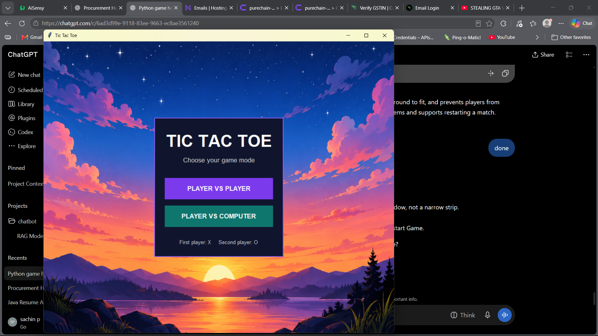
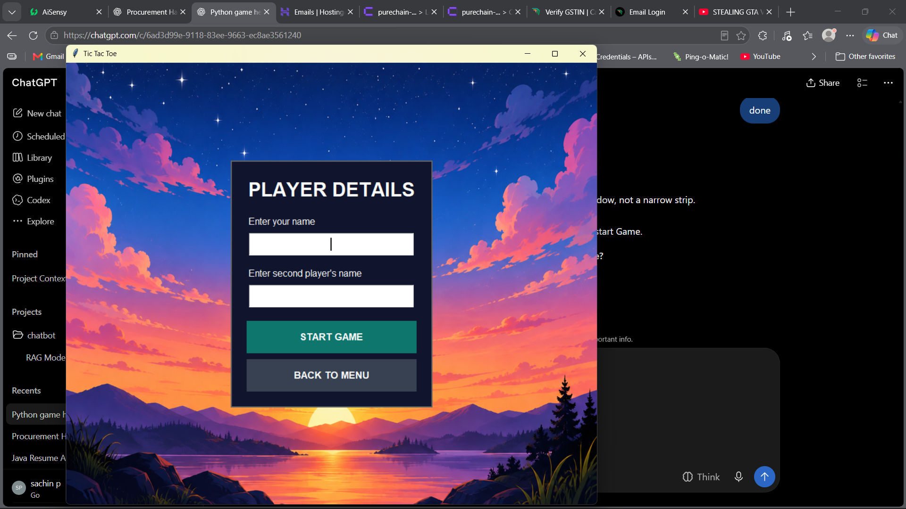
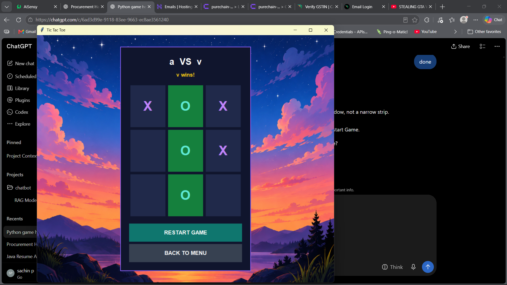
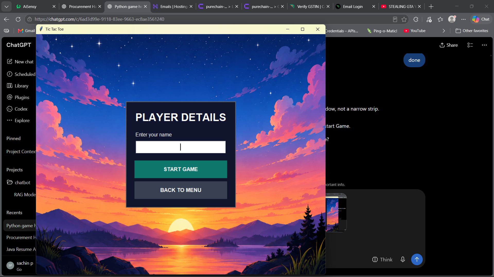
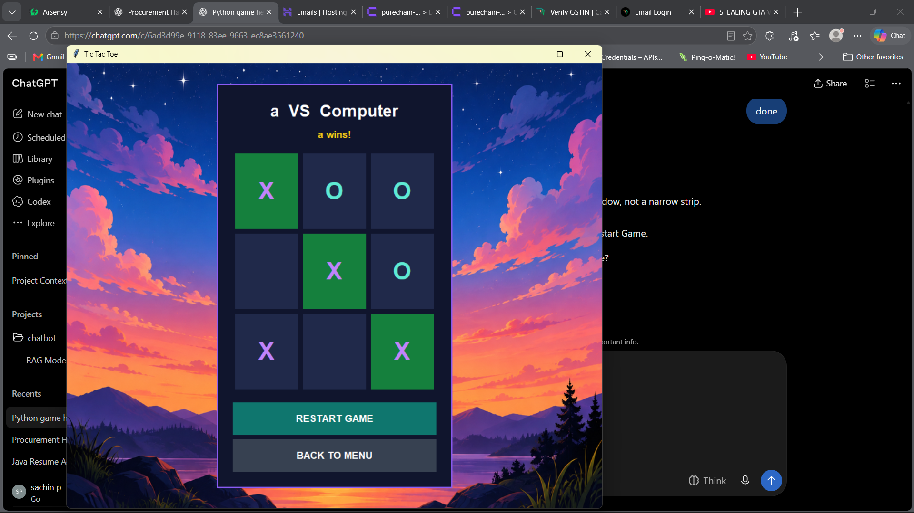

# 🎮 Tic Tac Toe Game

<h2 align="center">A Python Desktop Game</h2>

<p align="center">
  A classic Tic Tac Toe game built with Python, Tkinter, and Pillow.
  Play against a friend or challenge the computer!
</p>

<p align="center">
  
  
  
</p>

---

## ✨ Features

- 👥 **Player vs Player** — Play with another person.
- 🤖 **Player vs Computer** — Challenge the computer.
- 📝 **Custom Player Names** — Enter player names before starting.
- 🏆 **Winner Detection** — Automatically detects winning combinations.
- 🤝 **Draw Detection** — Identifies a draw when the board is full.
- 🟩 **Winning Cell Highlighting** — Highlights the winning combination.
- 🔄 **Restart Game** — Start another match instantly.
- 🏠 **Back to Menu** — Return to the main menu.
- 🖼️ **Resizable Background** — Background image adjusts to the window.

## 🛠️ Technologies Used

<p>
  
  
  
</p>

## 📸 Screenshots

### 1. Main Menu

<p align="center">
  
</p>

### 2. Player vs Player — Player Details

<p align="center">
  
</p>

### 3. Player vs Player — Match Result

<p align="center">
  
</p>

### 4. Player vs Computer — Player Details

<p align="center">
  
</p>

### 5. Player vs Computer — Match Result

<p align="center">
  
</p>

---

## 🚀 Installation and Setup

### Prerequisites

- Python 3 installed on your system.
- pip package manager.

### 1. Clone the Repository

```bash
git clone <your-repository-url>
cd Tictac
```

Replace `<your-repository-url>` with your actual GitHub repository URL.

### 2. Create a Virtual Environment

```bash
python -m venv .venv
```

Activate it on Windows:

```powershell
.venv\Scripts\Activate.ps1
```

### 3. Install Dependencies

```bash
python -m pip install Pillow
```

### 4. Run the Game

```bash
python tgame.py
```

Make sure `Simpback.png` or the fallback background `1.png` is available in the project directory.

## 🎯 How to Play

1. Launch the application.
2. Select **Player vs Player** or **Player vs Computer**.
3. Enter the required player name or names.
4. Click an empty square to place your mark.
5. Player 1 uses **X**, and Player 2 or the computer uses **O**.
6. Get three marks in a row, column, or diagonal to win.
7. If all nine cells are filled without a winner, the game ends in a draw.
8. Use **Restart Game** or **Back to Menu** to continue playing.

## 📂 Project Structure

```text
Tictac/
├── tgame.py
├── Simpback.png
├── 1.png
├── README.md
└── screenshots/
    ├── screenshot1.png
    ├── screenshot2.png
    ├── screenshot3.png
    ├── screenshot4.png
    └── screenshot5.png
```

## 👨‍💻 Author

**Sachin Paithane**

Python desktop application project created to practice GUI development and game logic.
